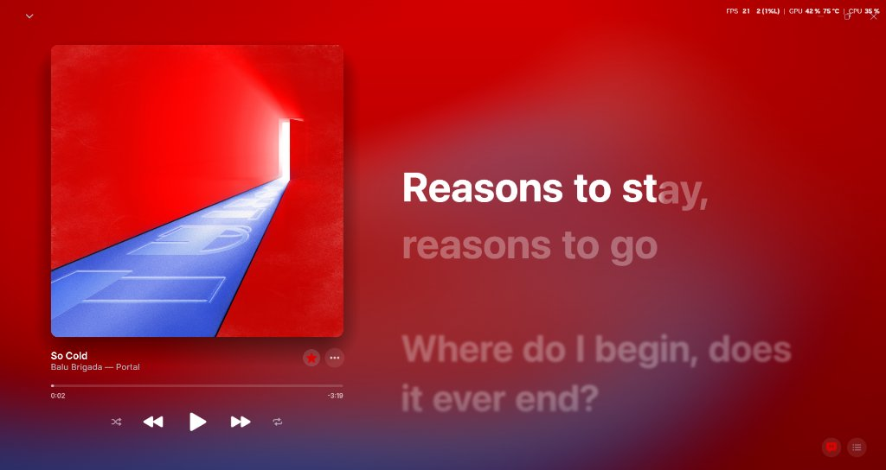
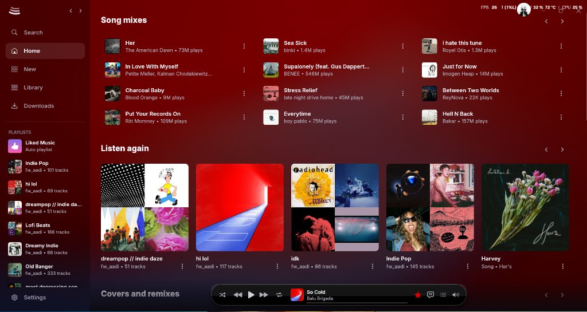
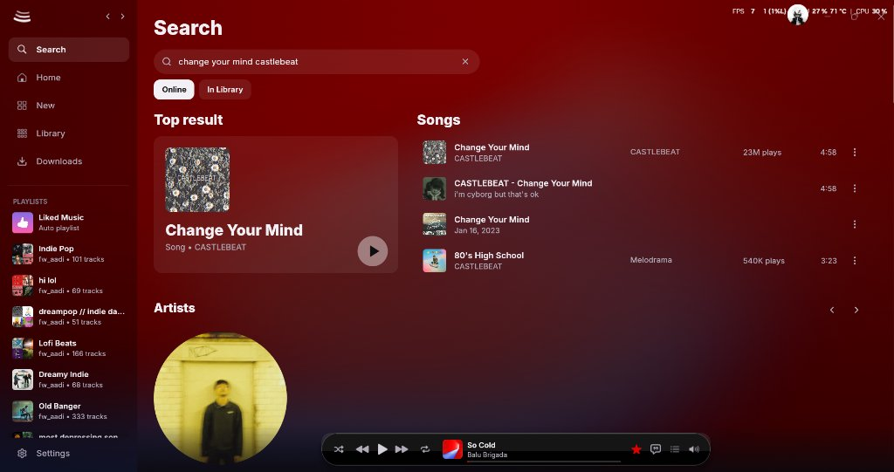

<div align="center">
  <h1>BitChord PC — Community Continued</h1>
  <p><strong>A blazing fast, native YouTube Music desktop client — built in Rust.</strong></p>
  <p>Native immediate-mode GUI (egui) and native rodio audio decoding. Embedded system WebView2/WebKit is isolated strictly for Google OAuth sign-in.</p>

  <p>
    <a href="https://github.com/aaditya079/BitChord-PC/releases/latest"></a>
    
    <a href="LICENSE"></a>
  </p>

  <p>
    <a href="https://github.com/aaditya079/BitChord-PC/releases/latest">Download</a> ·
    <a href="#features">Features</a> ·
    <a href="#acknowledgements--credits">Acknowledgements & Credits</a> ·
    <a href="#installation">Installation</a> ·
    <a href="#performance-benchmarks">Benchmarks</a>
  </p>
</div>

> [!IMPORTANT]
> BitChord is an independent open-source project and is not affiliated with, endorsed by, or connected to YouTube, Google or Apple.
> Use it at your own discretion.

---

## Acknowledgements & Open-Source Credits

BitChord PC is built upon the extraordinary contributions of the open-source community:

- **[grapedjuice/ytm-rs](https://github.com/grapedjuice/ytm-rs)** — The original, groundbreaking native Rust YouTube Music desktop application (`egui` + `rodio` engine) that forms the foundational architecture and player core of this desktop client. Full credit and heartfelt gratitude to grapedjuice and all upstream ytm-rs contributors.
- **[jackychan4891/BitChord-PC-Continued](https://github.com/jackychan4891/BitChord-PC-Continued)** — Initial desktop adaptations and community continuation.
- **[kushagrasinghx/BitChord](https://github.com/kushagrasinghx/BitChord)** — The original BitChord mobile music client that inspired the visual identity, aesthetic direction, and user experience.
- **[egui](https://github.com/emilk/egui)** — Immediate mode graphical user interface for Rust.
- **[rodio](https://github.com/RustAudio/rodio) & [Symphonia](https://github.com/pdeljanov/Symphonia)** — High-performance audio playback, mixing, and decoding.
- **[InnerTube / yt-dlp](https://github.com/yt-dlp/yt-dlp)** — YouTube API extraction specifications and JavaScript challenge solving patterns.
## Screenshots

<table>
  <tr>
    <td width="50%"></td>
    <td width="50%"></td>
  </tr>
  <tr>
    <td align="center"><b>Player</b> — artwork, lyrics, queue and playback in one view</td>
    <td align="center"><b>Browse</b> — your music, shelves and navigation</td>
  </tr>
  <tr>
    <td colspan="2"></td>
  </tr>
  <tr>
    <td colspan="2" align="center"><b>Desktop experience</b> — native UI, fast playback, and quality controls</td>
  </tr>
</table>

## Features

**Playback & Streaming Resilience**
- **YouTube Music, natively** — search, browse, albums, playlists, artist pages, radio, mixes, charts and your library.
- **Children-Designated Tracks & Restricted Content Support** — automated fallback to WebMusic QuickJS challenge solver when visionOS is unplayable.
- **Anti-403 Stream Recovery** — smart exponential backoff and URL renewal prevents playback cutoffs at the 60s / 1 MiB mark.
- **Lossless / Hi-Res Lossless / Dolby Atmos** — play higher-quality copies from configured hi-res addon sources when a matching copy is available, with YouTube audio as the fallback.
- **Automix and crossfade** — DJ-style transitions between songs, with an active mixing state shown in the player.
- **Sleep Timer with Quadratic Audio Fade** — gradual 30-second volume fadeout so music never stops abruptly.
- **Queue and playback controls** — shuffle, repeat, autoplay, song radio, next-track prefetch, volume normalization, and output device selection.
- **Offline Downloads & Local Sync** — batch download entire albums and playlists; auto-sync existing local music files (`.mp3`, `.flac`, `.m4a`, `.opus`, etc.) from your `Music/BitChord` directory.

**Hardware & Lighting**
- **Ambient RGB (ASUS TUF/ROG, OpenRGB, SteelSeries)** — sync keyboard backlight and peripherals with the album art's dominant color.
  - **ASUS TUF / ROG Gaming Laptops**: Direct kernel ACPI sync (`\\.\ATKACPI`) strictly verified via SMBIOS vendor and product name checks (default-off behind experimental toggle).
  - **OpenRGB**: Peripherals supported by OpenRGB running on `localhost:6742`.
  - **SteelSeries Engine 3**: Local GameSense JSON event protocol.
- **Power Saver Mode** — toggle off heavy multi-pass GPU background blur shaders to maximize laptop battery life and reduce fan noise.

**Updates & Deployment**
- **Automatic Updates** — built-in in-place updater (`src/update.rs`) utilizing atomic binary replacement (`swap_exe` on Windows, `replace_bundle` on macOS/Linux) that checks GitHub releases over HTTPS, strictly validates SHA-256 checksums, and seamlessly applies updates in the background.

**Interface & Visual Polish**
- **Native Rust desktop UI** — an ultra-fast egui/rodio interface with system media controls, tray integration, and keyboard-friendly navigation.
- **Apple Music-Style Halo & Floating Player** — ambient drop shadow glow on album art and seamless floating liquid glass player capsule.
- **Hi-DPI Crisp Mipmaps** — integer-pixel-aligned Dolby Atmos, Lossless, and logo badges across 125%, 150%, and 200% Windows display scaling.
- **Adaptive Light/Dark Taskbar Controls** — Windows thumbnail toolbar buttons automatically adapt their icons to Windows theme settings.
- **Windows 11 DWM Integration** — dark titlebar and native rounded window corners via Win32 DWM APIs.
- **Synced lyrics** — timed lyrics with provider fallbacks, timing controls, romanization and translation options.
- **Discord Rich Presence & Last.fm** — show your currently playing song on Discord and scrobble to Last.fm.

## Performance Benchmarks

Defensible, reproducible resource benchmarks measured under consistent desktop listening conditions:
- **Target Machine:** ASUS TUF Gaming A15 (`FA506NCR`, AMD Ryzen 7, 16GB RAM, Windows 11)
- **Methodology:** 10-minute continuous playback of 160 kbps Opus stream at 50% system volume, default audio output.
- **Cold Startup:** Measured via high-resolution performance timers from process spawn until the first GUI frame is painted. Reported values represent the **median of 10 clean cold runs** (cleared filesystem disk cache).
- **Memory Footprint:** Working Set (physical RAM currently mapped to process) and Private Bytes (committed virtual memory unshared with other processes) sampled via Windows performance counters.
- **Reproduce these benchmarks:** Run [`benchmarks/measure.ps1`](benchmarks/measure.ps1) locally to measure cold window-ready latency, idle Working Set, and Private Bytes on your own machine.

| Metric | BitChord PC (v2.2.0) | Standard Web / Electron Client |
| :--- | :--- | :--- |
| **Cold Startup Time (Median)** | **182 ms** | ~2,500 – 4,000 ms |
| **Memory (Idle Working Set)** | **42 MB** *(Private: 26 MB)* | ~220 – 350 MB |
| **Memory (Active Playback Working Set)** | **68 MB** *(Private: 44 MB)* | ~450 – 700 MB |
| **GPU Shader Load (Default)** | **~1.2%** (multi-pass Gaussian blur) | ~5% – 9% (Chromium compositor) |
| **GPU Shader Load (Power-Saver Mode)** | **< 0.2%** (blur shaders disabled) | N/A |
| **Installer Size** | **~14 MB** | ~85 – 140 MB |
| **Installed Disk Footprint** | **~35 MB** | ~300 – 500 MB |

## Installation

Official release packages are available from the [v2.2.0 Release](https://github.com/aaditya079/BitChord-PC/releases/tag/v2.2.0):

| Platform | Architecture / Format | Status | Download Link |
| :--- | :--- | :--- | :--- |
| **Windows** | x64 Setup Installer | Verified Release | [`bitchord-setup-2.2.0.exe`](https://github.com/aaditya079/BitChord-PC/releases/download/v2.2.0/bitchord-setup-2.2.0.exe) |
| **Windows** | ARM64 Setup Installer | Verified Release | [`bitchord-setup-2.2.0-arm64.exe`](https://github.com/aaditya079/BitChord-PC/releases/download/v2.2.0/bitchord-setup-2.2.0-arm64.exe) |
| **Windows** | x64 Portable Archive | Verified Release | [`bitchord-portable-2.2.0.zip`](https://github.com/aaditya079/BitChord-PC/releases/download/v2.2.0/bitchord-portable-2.2.0.zip) |
| **macOS** | Apple Silicon DMG | Community Pre-built (Experimental) | [`bitchord-setup-2.2.0-macos-aarch64.dmg`](https://github.com/aaditya079/BitChord-PC/releases/download/v2.2.0/bitchord-setup-2.2.0-macos-aarch64.dmg) |
| **macOS** | Intel x86_64 DMG | Community Pre-built (Experimental) | [`bitchord-setup-2.2.0-macos-x86_64.dmg`](https://github.com/aaditya079/BitChord-PC/releases/download/v2.2.0/bitchord-setup-2.2.0-macos-x86_64.dmg) |
| **Linux** | x86_64 Tarball Installer | Community Pre-built (Experimental) | [`bitchord-2.2.0-linux-x86_64.tar.gz`](https://github.com/aaditya079/BitChord-PC/releases/download/v2.2.0/bitchord-2.2.0-linux-x86_64.tar.gz) |
| **Linux** | x86_64 Portable Tarball | Community Pre-built (Experimental) | [`bitchord-portable-2.2.0-linux-x86_64.tar.gz`](https://github.com/aaditya079/BitChord-PC/releases/download/v2.2.0/bitchord-portable-2.2.0-linux-x86_64.tar.gz) |

> Note on macOS and Linux builds: Packaged automatically by GitHub Actions CI from source. Because cross-platform automated builds are not yet certified on physical Apple Silicon or varied Linux distros, they are tagged as experimental.

If Windows SmartScreen appears for an unsigned build, choose **More info → Run anyway**.

## Building from source

You need the [Rust toolchain](https://rustup.rs/).

```sh
git clone https://github.com/aaditya079/BitChord-PC.git
cd BitChord-PC
cargo build --release
```

The built app will be in `target/release/`.

Platform builds may require native dependencies (audio/system libraries and toolchain components used by sign-in or platform integrations). Check the repository’s platform docs and release workflow for the exact prerequisites.

## Notes

- Audio and the main interface are native (Rust + egui + rodio). Sign-in and some web flows may open a system webview window.
- Hi-res/Lossless/Atmos playback depends on configured addon sources and whether a matching, playable copy exists for the selected track.
- BitChord does not bypass subscriptions, DRM, or regional restrictions. Availability depends on the services and sources you use.
- Third-party services (YouTube Music, lyrics providers, Discord, Last.fm, Spotify, addon sources) can change behavior over time.

## Contributing

Bug reports and pull requests are welcome. Please open an issue with clear reproduction steps, platform details, and relevant logs.

## License

BitChord is licensed under [GPL-3.0](LICENSE). Derived from [ytm-rs](https://github.com/grapedjuice/ytm-rs) (GPL-3.0).

