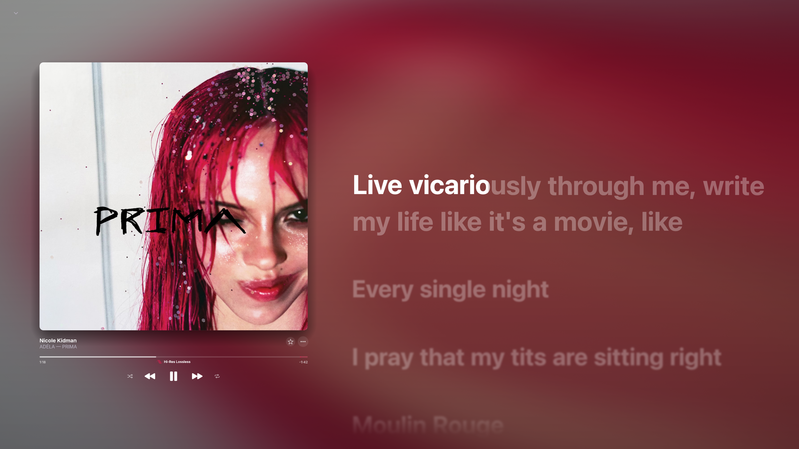
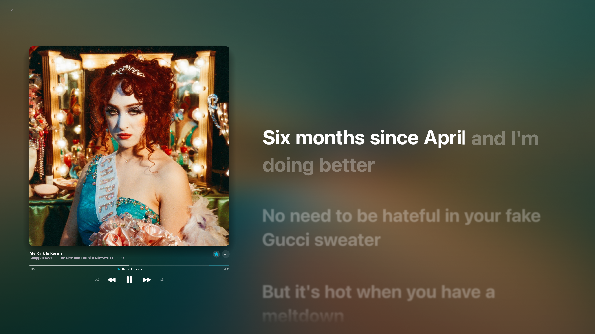
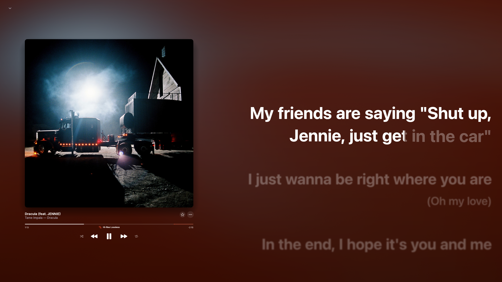

<div align="center">
  <h1>BitChord PC — Community Continued</h1>
  <p><strong>A blazing fast, native YouTube Music desktop client — built in Rust.</strong></p>
  <p>Engineered with egui and rodio. No Electron, zero webview audio overhead, and featherweight memory usage.</p>

  <p>
    <a href="https://github.com/aaditya079/BitChord-PC/releases/latest"></a>
    
    <a href="LICENSE"></a>
  </p>

  <p>
    <a href="https://github.com/aaditya079/BitChord-PC/releases/latest">Download</a> ·
    <a href="#features">Features</a> ·
    <a href="#acknowledgements--credits">Acknowledgements & Credits</a> ·
    <a href="#installation">Installation</a>
  </p>
</div>

> [!IMPORTANT]
> BitChord is an independent open-source project and is not affiliated with, endorsed by, or connected to YouTube, Google or Apple.
> Use it at your own discretion.

---

## Acknowledgements & Open-Source Credits

BitChord PC is built upon the extraordinary contributions of the open-source community:

- **[ytm-rs by grapedjuice](https://github.com/grapedjuice/ytm-rs)** — The original, groundbreaking native Rust YouTube Music desktop application (`egui` + `rodio` engine) that forms the foundational architecture and player core of this desktop client. Full credit and heartfelt gratitude to grapedjuice and all upstream ytm-rs contributors.
- **[BitChord by Kushagra Singh](https://github.com/kushagrasinghx/BitChord)** — The original BitChord mobile music client that inspired the visual identity, aesthetic direction, and user experience.
- **[egui](https://github.com/emilk/egui)** — Immediate mode graphical user interface for Rust.
- **[rodio](https://github.com/RustAudio/rodio) & [Symphonia](https://github.com/pdeljanov/Symphonia)** — High-performance audio playback, mixing, and decoding.
- **[InnerTube / yt-dlp](https://github.com/yt-dlp/yt-dlp)** — YouTube API extraction specifications and JavaScript challenge solving patterns.
## Screenshots

<table>
  <tr>
    <td width="50%"></td>
    <td width="50%"></td>
  </tr>
  <tr>
    <td align="center"><b>Player</b> — artwork, lyrics, queue and playback in one view</td>
    <td align="center"><b>Browse</b> — your music, shelves and navigation</td>
  </tr>
  <tr>
    <td colspan="2"></td>
  </tr>
  <tr>
    <td colspan="2" align="center"><b>Desktop experience</b> — native UI, fast playback, and quality controls</td>
  </tr>
</table>

## Features

**Playback & Streaming Resilience**
- **YouTube Music, natively** — search, browse, albums, playlists, artist pages, radio, mixes, charts and your library.
- **Children-Designated Tracks & Restricted Content Support** — automated fallback to WebMusic QuickJS challenge solver when visionOS is unplayable.
- **Anti-403 Stream Recovery** — smart exponential backoff and URL renewal prevents playback cutoffs at the 60s / 1 MiB mark.
- **Lossless / Hi-Res Lossless / Dolby Atmos** — play higher-quality copies from configured hi-res addon sources when a matching copy is available, with YouTube audio as the fallback.
- **Automix and crossfade** — DJ-style transitions between songs, with an active mixing state shown in the player.
- **Sleep Timer with Quadratic Audio Fade** — gradual 30-second volume fadeout so music never stops abruptly.
- **Queue and playback controls** — shuffle, repeat, autoplay, song radio, next-track prefetch, volume normalization, and output device selection.
- **Offline Downloads & Local Sync** — batch download entire albums and playlists; auto-sync existing local music files (`.mp3`, `.flac`, `.m4a`, `.opus`, etc.) from your `Music/BitChord` directory.

**Hardware & Lighting**
- **Universal Dynamic Ambient RGB Sync** — sync keyboard backlight and peripherals with the album art's dominant color. Direct kernel ACPI support for ASUS TUF (`\\.\ATKACPI`), OpenRGB TCP bridge (`127.0.0.1:6742`), and SteelSeries GameSense loopback.
- **Power Saver Mode** — toggle off heavy multi-pass GPU background blur shaders to maximize laptop battery life and reduce fan noise.

**Interface & Visual Polish**
- **Native Rust desktop UI** — an ultra-fast egui/rodio interface with system media controls, tray integration, and keyboard-friendly navigation.
- **Apple Music-Style Halo & Floating Player** — ambient drop shadow glow on album art and seamless floating liquid glass player capsule.
- **Hi-DPI Crisp Mipmaps** — integer-pixel-aligned Dolby Atmos, Lossless, and logo badges across 125%, 150%, and 200% Windows display scaling.
- **Adaptive Light/Dark Taskbar Controls** — Windows thumbnail toolbar buttons automatically adapt their icons to Windows theme settings.
- **Windows 11 DWM Integration** — dark titlebar and native rounded window corners via Win32 DWM APIs.
- **Synced lyrics** — timed lyrics with provider fallbacks, timing controls, romanization and translation options.
- **Discord Rich Presence & Last.fm** — show your currently playing song on Discord and scrobble to Last.fm.

## Installation

Download the latest build from [Releases](https://github.com/jackychan4891/BitChord-PC-Continued/releases/latest).

- **Windows** — download the Windows release asset, extract/install it, and run `bitchord.exe`.
- **macOS / Linux** — use the platform release assets when available.

If Windows SmartScreen appears for an unsigned build, choose **More info → Run anyway**.

## Building from source

You need the [Rust toolchain](https://rustup.rs/).

```sh
git clone https://github.com/jackychan4891/BitChord-PC-Continued.git
cd BitChord-PC-Continued
cargo build --release
```

The built app will be in `target/release/`.

Platform builds may require native dependencies (audio/system libraries and toolchain components used by sign-in or platform integrations). Check the repository’s platform docs and release workflow for the exact prerequisites.

## Notes

- Audio and the main interface are native (Rust + egui + rodio). Sign-in and some web flows may open a system webview window.
- Hi-res/Lossless/Atmos playback depends on configured addon sources and whether a matching, playable copy exists for the selected track.
- BitChord does not bypass subscriptions, DRM, or regional restrictions. Availability depends on the services and sources you use.
- Third-party services (YouTube Music, lyrics providers, Discord, Last.fm, Spotify, addon sources) can change behavior over time.

## Contributing

Bug reports and pull requests are welcome. Please open an issue with clear reproduction steps, platform details, and relevant logs.

## License

BitChord is licensed under [GPL-3.0](LICENSE). Derived from [ytm-rs](https://github.com/grapedjuice/ytm-rs) (GPL-3.0).

